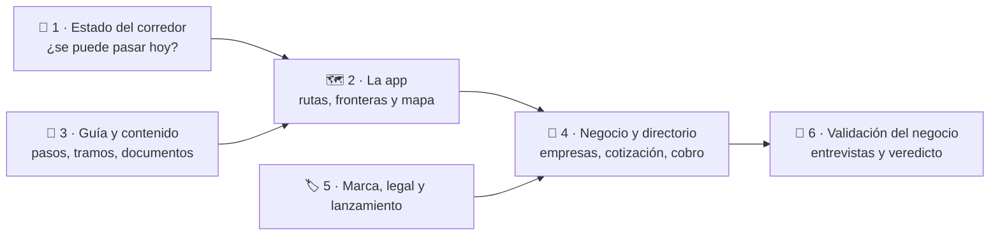

# ◆ Guía del Corredor Bioceánico

**Para qué sirve:** que un transportista, un despachante o una empresa que cotiza sepa en un minuto si puede cruzar el Corredor Bioceánico (Brasil – Paraguay – Argentina – Chile), por dónde, y con qué datos confirmados.

- 🌐 Web: **https://elezcano.github.io/GuiaCorredor/**
- 📦 Datos abiertos: [`/api/v1/indice.json`](https://elezcano.github.io/GuiaCorredor/api/v1/indice.json)
- ✉️ Contacto: elezcanofm@gmail.com · Responsable editorial y de verificación: **Ernesto**

> **Estado: borrador (MVP).** Regla de oro: **la fiabilidad va antes que la cantidad.** El estado de pasos y carreteras lo deciden solo las fuentes oficiales, y todo dato lleva su fuente y su fecha.

---

## Qué puedes hacer hoy en la web

| Necesito… | Dónde |
|---|---|
| Saber si un paso está abierto, ahora | Ficha del paso: **semáforo** (Abierto · Con restricciones · No habilitado · Sin confirmar), hora local de cada país y «abierto ahora / cierra en…» |
| Saber si una carretera está cortada | **Rutas** y ficha del paso («Carreteras para llegar»): *Sin incidencias*, *Con incidencias* o *Cortado*, según la fuente oficial de cada país, leída cada hora |
| Saber de quién es el dato y de cuándo | Ficha del paso: **«Qué informa cada país»**, con organismo, fecha y hora, y aviso si el parte tiene más de 48 h |
| Ver el paso en mi sentido de viaje | Ficha del paso: botón **«⇄ Cambiar sentido»**, que ordena controles y partes según el país del que sales y en el que entras (también en el enlace: `?sentido=CL-AR`) |
| Llamar a la frontera | Ficha del paso: **botón Llamar** con teléfonos de fuente oficial |
| Saber qué controles pasa un camión | Ficha del paso: **controles para carga en orden** (integrado, migraciones, aduana, sanitario) |
| Ver qué ha pasado en un paso | Ficha del paso: **novedades** en línea de tiempo |
| Saber cuánto se cierra un paso | Ficha del paso: **fiabilidad**, días no habilitado (en total y solo para carga) en los últimos 30 y 90 días |
| Planificar una ruta y una fecha | **Planificador** y **informe de viaje** para enviar por WhatsApp, enlace o PDF, o como **resumen en una página** para quien cotiza |
| Ver obras, cortes y festivos | Avisos y calendario aduanero |
| Usar los datos en otro sistema | `api/v1` (JSON abierto, versionado) |

**Lo que no es:** un marketplace de cargas, un intermediario de pagos, un sitio de reseñas ni un seguimiento de camiones. Los avisos de cadenas y clima en tiempo real llegarán en otra fase (#69).

---

## El proyecto en 6 bloques

Cada tarjeta de Trello lleva el número de su bloque (por ejemplo, **1.4**) y la historia de usuario entre paréntesis (**HU-134**).



| Bloque | Qué resuelve | Tarjetas |
|---|---|---|
| 🚦 **1 · Estado del corredor** | Si hoy se puede pasar, con la fuente oficial de cada país leída cada hora | ✅ 1.1 Vigilante fiable · ✅ 1.2 Fuentes oficiales y página «Fuentes» · ✅ 1.3 Fuentes de Brasil · ✅ 1.4 Carreteras de Paraguay (MOPC) · ✅ 1.5 Carreteras de Brasil (DNIT) · ✅ 1.6 Tres estados por tramo · ⏳ 1.7 Partes a 24 h en invierno · ⏳ 1.8 Avísame si cambia |
| 🗺️ **2 · La app** | Planificar la ruta y ver cada frontera desde el móvil | ✅ 2.1 Rediseño Versión 2 · ✅ 2.2 Portugués · 🔧 2.3 Red completa de Santos a Iquique · ⏳ 2.4 Datos esenciales de la fase 1 |
| 📖 **3 · Guía y contenido** | Qué pide cada paso, cada tramo y cada documento | ⏳ 3.1 Las 15 páginas · ⏸ 3.2 Fichas de puerto · ⏳ 3.3 Ficha de ciudad · ⏳ 3.4 Despachante revisor · ⏳ 3.5 Artículos y boletín |
| 💼 **4 · Negocio y directorio** | Que las empresas del corredor estén y paguen por destacar | 🔧 4.0 MVP · ⏳ 4.1 Cotización y camión vacío · ⏳ 4.2 300 empresas · ⏳ 4.3 Revisar solicitudes · 🚦 4.4 Hito 150 empresas / 10 de pago · ⏳ 4.5 Comercial en Paraguay · ⏳ 4.6 Generador CRT y MIC/DTA |
| 🏷️ **5 · Marca, legal y lanzamiento** | Nombre propio, dominio y poder cobrar cumpliendo la ley | ⏳ 5.1 Tres nombres de marca · ⏳ 5.2 Dominio y perfiles · ⏳ 5.3 Textos legales y PayPal · ⏸ 5.4 Contador |
| 🧪 **6 · Validación del negocio** | Saber si seguir o parar | ⏳ 6.1 12 entrevistas · ⏳ 6.2 Responsable de flota · 🚦 6.3 Veredicto (31/01/2027) |

✅ hecho · 🔧 en curso · ⏳ pendiente · ⏸ aplazado · 🚦 hito de decisión

---

## Cómo trabajamos

1. **Cada mejora es una historia de usuario** (issue en GitHub y tarjeta en Trello): «en curso» → «hecho».
2. **Se desarrolla en una rama** y se abre una PR. Nada llega a la web sin que Ernesto lo pruebe y diga «publica».
3. **Solo las fuentes oficiales deciden el estado.** Lo que el vigilante lee cada hora de una web oficial (Gendarmería, Vialidad Nacional, Vialidad de Chile, MOPC, DNIT) se publica al momento con «✓ Web oficial». Lo de prensa queda como contexto, en gris, con el nombre del medio. La IA nunca marca como verificado un dato cargado a mano: eso lo dice Ernesto («confirmo …»).
4. **«Tareas del día» solo llega si hace falta una persona:** los partes de Chile por WhatsApp (se reenvían como captura) y las alertas que el vigilante no sabe clasificar.
5. **Los avisos del vigilante solo informan** de lo que ha publicado; se cierran solos al día siguiente.
6. **Antes de publicar, GitHub lo revisa todo solo:** datos y esquemas, coherencia web/API, enlaces, verificaciones nuevas (exigen la etiqueta `revision-editorial`) y **pruebas de navegador**. Si algo falla, no se publica.

### Pruebas automáticas

GitHub abre la web en un navegador real, a tamaño móvil y en tema claro y oscuro, y comprueba que funciona lo que ya funcionaba: portada, planificador, mapa, fichas de paso, informe de viaje y partes por organismo. Usa datos y reloj fijos, así que el resultado no cambia con los días ni al editar datos reales. Si una prueba falla, la PR sale en rojo y no se publica. Detalle en [`pruebas/LEEME.md`](pruebas/LEEME.md).

---

## Registro de avances

Lo más reciente, arriba.

| Fecha | Avance | Dónde |
|---|---|---|
| 20/11/2026 | #196 | Mapas de OpenStreetMap interactivos en la ficha de paso, la guía de tramo y el planificador, centrados en lo que miras; Mapa interactivo en V2. |
| 20/11/2026 | #194 | Avisos y Fuentes que vigilamos en V2: una línea por aviso o fuente, detalle al abrir y dos columnas. |
| 20/11/2026 | #191 | Mapas con el mismo encuadre (corredor entero o centrado en el paso o la ruta) y tablero con bandera y nombre del país. |
| 20/11/2026 | #192 | Vigilante: lee el «Motivo del cierre» de Gendarmería en la web oficial del paso y lo cita en el estado. |
| 20/11/2026 | #189 | Pie con 5 enlaces: mapa, anunciarse, cómo trabajamos, fuentes y contacto. |
| 20/11/2026 | #187 | Rediseño V2: menú lateral/inferior, «Estado» con tablero de pasos, iconos Tabler y señales de carril, Rutas y Fronteras en dos columnas, página /cotizar/ (sin email personal) y prueba del sistema de diseño en 3 tamaños. |
| 20/11/2026 | #183 | Avisos cortos (una línea + «Más información»), MOPC como mucho en ámbar (rojo solo si nombra la PY15: regla apagada) e historial de 90 días. |
| 19/11/2026 | **Solo las fuentes oficiales deciden:** la prensa sin verificar queda como contexto y no cambia el estado; sin sello amarillo «Sin verificar» (cada dato dice de qué tipo es su fuente); «Tareas del día» solo con los partes de Chile por WhatsApp y las alertas sin clasificar | #175 |
| 19/11/2026 | **Sin incidencias / Con incidencias / Sin vigilancia:** los tramos vigilados dejan de salir «Sin confirmar»; «Carreteras para llegar» en cada paso; portada con lo que impide primero y el resto en una línea; la página consulta en vivo cuándo se leyó cada fuente (decisión 22) | #173 |
| 18/11/2026 | **Vigilante del DNIT (Brasil):** el vigilante lee las «Alertas DNIT» y publica las de la BR-060 y la BR-267 en MS (Campo Grande → Porto Murtinho) con el sello «✓ Web oficial»; lo que no sabe clasificar queda para revisar a mano | #170 |
| 18/11/2026 | **Vigilante del MOPC (Paraguay):** el vigilante lee el informe diario «Estado de las rutas nacionales» (PDF en Drive, de lunes a viernes a las 07:00 y 13:00) y publica los cierres de la PY15 y de Boquerón con el sello «✓ Web oficial»; «Clausurada P/V/P» → no habilitado para carga | #167 |
| 18/11/2026 | **PY15, recorrido real:** el tramo 2 (Cruce Centinela – Mariscal) no está construido; se va por Loma Plata, Filadelfia y la Transchaco. Superficie de cada tramo con el inventario vial del MOPC | #166 |
| 18/11/2026 | **Publicación fiable:** fusionar un PR ya no cancela la publicación de la web; cada cambio en main se publica solo, sin lanzarlo a mano | #162 |
| 18/11/2026 | **Fuentes oficiales de Brasil:** el tramo Campo Grande → Porto Murtinho deja de estar «sin fuente»: BR-060 y BR-267 con las «Alertas DNIT» (pendientes de su lector, HU-138), la PRF como fuente manual, el acceso brasileño al puente (en obras, previsto 2027) y la aduana de Porto Murtinho (prevista 2028) | #160 |
| 18/11/2026 | **Fuentes en CSV y web completa en portugués:** el vigilante se configura con `data/fuentes-vigilancia.csv` (pausar una fuente o mover una carretera de tramo sin tocar código; `npm run check` lo valida) y la lista se publica en «Fuentes que vigilamos». Todas las páginas en portugués (/pt/), con la guía traducida. Mapa interactivo rediseñado (formas de estado y lista de tramos); Avisos, Calendario y Papeles con el diseño V2 | #156 |
| 18/11/2026 | **La Guía en portugués de Brasil:** Hoje, Rotas, Fronteiras, fichas de paso y Serviços en /pt/, con selector ES \| PT en la cabecera que se recuerda; hora de referencia de Campo Grande; avisos oficiales y datos sin traducir («texto oficial em espanhol»); hreflang para buscadores. Se generan solas desde las páginas españolas con un diccionario de frases. Paso 2 de 3 | #150 |
| 18/11/2026 | **Rediseño Versión 2 (la web como app):** menú de 4 (Hoy, Rutas, Fronteras, Servicios); portada «Hoy» con tu ruta guardada y su veredicto en una frase («Puedes ir hoy por Sico»); estado con color, forma y palabra; sello único «Organismo · cuándo · ✓ Web oficial»; horarios con la hora del país y la de España; ficha del paso con pestañas Hoy, Papeles (marcables) y Calendario (¿cuándo cruzas?); Servicios con las 11 categorías; se ve sin conexión con la hora de los datos. Paso 1 de 3 (luego portugués, HU-135, y «Avísame», HU-132) | #143 |
| 17/11/2026 | **Chile, por posición en el mapa:** las emergencias de Vialidad de Chile (Tarapacá y Antofagasta) se asignan al tramo cuyo trazado pasa a menos de 3 km, así entran la Ruta 5, la Ruta 1 y el acceso a Iquique. Hoy: 2 registros antiguos en el ramal de Iquique (Ruta 1 y Ruta 16), en ámbar y «confírmalo». HU-130 terminada | #130 |
| 17/11/2026 | **El vigilante vigila las carreteras:** Vialidad Nacional (RN 9, 34, 51, 52 y 66 del corredor, cada hora) y Vialidad de Chile (emergencias de la región de Antofagasta, semanal). Lo publica como aviso del tramo con el sello «Web oficial»; un corte o un «no habilitado para carga» bloquea la ruta en el planificador | #130 |
| 17/11/2026 | **El vigilante publica al momento (pasos argentinos):** lee el estado de Gendarmería, el de Vialidad, el horario y el recuadro «Atención» de la web oficial de Jama, Sico y Misión La Paz; lo comprueba, lo sube y publica la web con el sello «Web oficial»; después avisa por correo. Pruebas con las páginas oficiales guardadas | #130 |
| 17/11/2026 | **Vigilante fiable:** pasadas cada hora desde cron-job.org, estado de cada fuente guardado en la rama `datos-vigilancia`, aviso si una fuente falla 3 veces seguidas y estado de la vigilancia en las tareas del día | #129 |
| 17/11/2026 | **Planificador rediseñado:** primero el veredicto («Hoy no se puede hacer entera», «Se puede hoy, con dudas», «Sin problemas conocidos»), qué lo impide y qué parte funciona hoy; opciones en tarjetas; tramo a tramo, avisos, papeles y festivos plegados; km por tipo (con fuente, calculados, estimados). Cualquier origen y destino de la red, en los dos sentidos. El tipo de carga sale de la búsqueda y pasa a «Papeles», que es lo único que cambia | #116 |
| 17/11/2026 | **Contraste con Google Maps:** coordenadas y km de la red confirmados; Carmelo Peralta → Mariscal pasa a 379,4 km calculados (los 307 km eran una resta sin fuente); el puente queda sin distancia hasta el dato oficial; los dos puentes fronterizos ya tienen coordenadas | #115 |
| 17/11/2026 | **Puertos de Chile por separado:** San Pedro de Atacama, Calama, Antofagasta, Mejillones e Iquique son puntos propios; Mejillones e Iquique, como ramales desde Calama. El planificador ya calcula rutas a cada puerto | #115 |
| 17/11/2026 | **Mapa interactivo** con MapLibre y teselas de OpenFreeMap (OpenStreetMap), con el estado de cada tramo y paso, y cálculo de trazados por carretera con OSRM (en revisión) | #115 |
| 17/11/2026 | **Ficha de paso más corta:** la decisión en la primera pantalla (estado, hora de cierre, qué dice cada país, últimos 30 días y Llamar · Compartir · Planificar) y lo demás plegado. Jama pasa de 15 a 4 pantallas de móvil | #113 |
| 17/11/2026 | **La web no nombra a nadie:** las insignias dicen «Verificado en fuente oficial» o «Verificado en la fuente», y los textos públicos ya no mencionan a ninguna persona | #107 |
| 17/11/2026 | **Ficha de paso por sentido de cruce** con botón «⇄»; el planificador abre cada ficha en el sentido del viaje | #105 |
| 17/11/2026 | **Tareas del día por correo** para el responsable editorial | #99 |
| 17/11/2026 | **Fiabilidad de cada paso:** días no habilitado, sin paso para carga, con restricciones, habilitado y sin datos en 30 y 90 días, solo con partes verificados. El relleno de agosto a noviembre espera la confirmación de Ernesto | #97 |
| 17/11/2026 | **Feriados verificados:** Paraguay 2027 (con los trasladables marcados), Argentina, Chile y Brasil, comprobados contra sus leyes | PR #103, #104 |
| 17/11/2026 | **Jama sin paso para carga por viento** (UPF Chile, 16/11): primer parte del lado chileno y texto claro de «no habilitado para carga» | PR #93, #94 |
| 17/11/2026 | **Vigilante con horario:** solo avisa dentro del horario de cada paso (hora de Argentina), y cada correo lleva la hora de Argentina y de España | — |
| 16/11/2026 | **Primeros avisos del vigilante atendidos:** partes de Gendarmería y Vialidad en Jama, Sico y Pozo Hondo; horario de Sico corregido (09:00–19:00) y de Jama aclarado (09:00–19:15). El vigilante pasa a revisar cada hora | #86 |
| 15/11/2026 | **Informe resumido en una página:** estado y último parte de cada paso, lo importante, avisos, distancia y papeles en una hoja A4 | #80 |
| 15/11/2026 | **Vigilante de webs oficiales:** cada hora revisa Gendarmería y Vialidad y avisa por correo si hay un parte más nuevo que el cargado | #77 |
| 15/11/2026 | **Pruebas automáticas en GitHub:** las pruebas de navegador se ejecutan en cada cambio y bloquean la publicación si algo falla | #50 |
| 15/11/2026 | **Partes por organismo** con fecha, hora y aviso de antigüedad a partir de 48 h (se bajará a 24 h en mayo/junio de 2027) | #73 |
| 15/11/2026 | **Los cuatro pasos con estado verificado.** Sico, habilitado con horario (corregido el 16/11 a 09:00–19:00). Aviso en la RN 51 | PR #72 |
| 15/11/2026 | **Teléfonos verificados** de Jama, Sico y Pozo Hondo, con la etiqueta exacta de la web oficial | PR #71 |
| 15/11/2026 | **Fichas de paso:** hora local y «abierto ahora», controles para carga, botón Llamar y novedades del paso | #65–#68 |
| 15/11/2026 | **Informe de viaje** por ruta y fecha, para WhatsApp, enlace o PDF | #45 |
| 15/11/2026 | **Semáforo operativo**, banderas, respuesta en una línea y mapa por tramos | — |
| 15/11/2026 | **Puente de la Bioceánica, Pozo Hondo y Jama** verificados por Ernesto | — |
| 15/11/2026 | **Formulario de Google** para solicitudes de empresas (hoja privada) | — |
| 14/11/2026 | **P0 Fiabilidad:** verificación humana, fuentes, esquemas, calidad automática y `api/v1` | [informe](docs/informe-p0.md) |

## Próximos pasos

Ver la tabla de [El proyecto en 6 bloques](#el-proyecto-en-6-bloques). Lo siguiente: **2.3** red completa de Santos a Iquique; con una decisión de Ernesto, **1.8** Avísame y **4.1** cotización; antes del lanzamiento, **5.1–5.3** marca, dominio y textos legales.

Plan completo por fases: [P0](../../issues?q=label%3AP0) · [P1](../../issues?q=label%3AP1) · [P2](../../issues?q=label%3AP2) · [P3](../../issues?q=label%3AP3).

---

<details>
<summary><strong>Decisiones aprobadas</strong></summary>

| # | Decisión |
|---|---|
| 1 | Plan de la [auditoría](docs/auditoria-2026-11.md) aprobado, por fases P0 → P1 → P2 → P3 |
| 2 | Arquitectura **estática** en GitHub Pages. Sin backend ni base de datos externa en esta fase |
| 3 | Primero, modelo de datos normalizado y exportación JSON estable (`api/v1`) |
| 4 | Claude, con conectores, es el entorno de trabajo asistido del equipo ([`docs/ia-dev.md`](docs/ia-dev.md)) |
| 5 | GitHub es la fuente de verdad del código y de los datos publicados |
| 6 | Issues de GitHub y Trello (tablero *Guía del Corredor Bioceánico*) para tareas |
| 7 | La verificación humana corresponde a Ernesto (`responsable-editorial`). Nunca a la IA |
| 8 | Contacto del proyecto: elezcanofm@gmail.com |
| 9 | Prioridad: datos fronterizos, información aduanera y primeras empresas verificadas |
| 10 | Distancias: estimación provisional en línea recta donde no hay dato con fuente, indicando el tramo exacto |
| 11 | Lo que no se pueda justificar con fuente se retira provisionalmente |
| 12 | Solicitudes de empresas a un formulario de Google con hoja privada |
| 13 | Cambios de formato de la API avisados ([`docs/api-cambios.md`](docs/api-cambios.md)); la versión anterior se mantiene 6 meses |
| 14 | `main` sin proteger mientras la web sea un borrador (#49) |
| 15 | **Foco en la operatividad:** la situación operativa va primero en cada ficha |
| 16 | **Semáforo operativo** con icono, texto y color; legible en móvil al sol y de noche |
| 17 | Aviso de antigüedad de los partes a partir de 48 h; 24 h desde mayo/junio de 2027 |
| 18 | Las pruebas de navegador se ejecutan en GitHub en cada cambio y bloquean la publicación si fallan |
| 19 | Avisos del vigilante por correo (incidencia de GitHub asignada a Ernesto); WhatsApp, más adelante y solo por vía oficial |
| 20 | Los datos oficiales leídos automáticamente se publican con su propia etiqueta («dato oficial leído automáticamente»); el semáforo y las fuentes de prensa siguen necesitando verificación humana (#100) |
| 21 | Cada día, a las 14:07 de España, Ernesto recibe por correo la lista «Tareas del día» (#99) |
| 22 | **Avisar de incidencias:** lo que el vigilante lee de una web oficial se publica al momento con la etiqueta «leído de la web oficial», sin esperar confirmación; Ernesto lo revisa después. La web dice «Sin incidencias», «Incidencia» o «Sin vigilancia» en lugar de «Sin confirmar». Amplía la 20 (#129, #130, #131) |
| 23 | El vigilante se lanza cada hora desde cron-job.org (token de GitHub con permisos mínimos, guardado solo allí); la pasada programada de GitHub queda de respaldo. Si una fuente falla 3 pasadas seguidas, aviso por correo (#129) |
| 24 | Para los pasos argentinos, el vigilante lee las variables que escribe el servidor oficial (`estadoPrioridad` de Gendarmería, `estadoVialidad`, horario y recuadro «Atención»), nunca la etiqueta «Abierto/Cerrado» de pantalla, que calcula el navegador con la hora del dispositivo. «Cerrado» dentro del horario se publica en rojo; fuera del horario es el cierre de cada noche. Corte total o circulación restringida de Vialidad con el paso abierto: ámbar. Nunca marcha atrás; solo reabre lo que él cerró (#130) |
| 25 | Carreteras: el vigilante lee la tabla oficial de Vialidad Nacional (la misma que carga su página «Estado de rutas») y las emergencias de Vialidad de Chile (SIEMOP, región de Antofagasta) y las publica como incidencias del tramo. Corte total o tránsito no operativo: rojo. «Peso restringido», «Sólo vehículos livianos» o «Sólo doble tracción»: «No habilitado para carga». Restringida o parcialmente operativa: ámbar. Observaciones de una ruta habilitada: informativas, sin cambiar el veredicto del planificador. En Chile cada emergencia se asigna por posición: rutas nacionales a menos de 3 km del trazado del tramo (los caminos secundarios que salen de la ruta no cuentan). Un registro chileno sin novedades de Vialidad en más de 14 días se publica en ámbar («puede estar ya resuelto, confírmalo») y no bloquea (#130) |
| 26 | **Solo las fuentes oficiales deciden el estado** (19/11/2026). Un aviso de prensa sin verificar queda como contexto (gris, con el nombre del medio) y no cambia el estado ni el veredicto. Sin sello amarillo «Sin verificar»: cada dato dice de qué tipo es su fuente. «Tareas del día» solo con lo que necesita una persona (#175) |

</details>

<details>
<summary><strong>Para desarrolladores: uso, estructura y publicación</strong></summary>

### Uso

Requisito: Node 20 o superior.

```bash
npm install              # una vez
npm run check            # esquemas JSON + reglas de contenido y calidad
npm run prueba           # genera la web y la API y comprueba coherencia y enlaces internos
npm run pruebas          # pruebas de navegador (necesita Playwright, ver pruebas/LEEME.md)
npm run dev              # genera y abre http://localhost:4321
npm run verificaciones   # verificaciones nuevas respecto a main
npm run enlaces-externos # comprueba las URL externas (informe, no bloquea)
```

Cómo editar datos, añadir fuentes, verificar y tramitar solicitudes: [`docs/como-editar.md`](docs/como-editar.md).

### Estructura

```
data/                Datos (fuente de verdad): pasos, rutas, incidencias, festivos, organismos,
                     directorio, novedades, fuentes… y esquemas/ (JSON Schema 2020-12)
content/guia/        Fichas de la guía en Markdown
scripts/             build (web + api/v1), check, validación, API, estimaciones, enlaces…
src/assets/          CSS y JavaScript del navegador
pruebas/             Pruebas de navegador, con datos fijos en pruebas/datos/
docs/                Auditoría, política de validación, Claude, cómo editar, cambios de la API
```

### Flujo de datos

```
Fuente oficial ──► propuesta en una rama («por verificar») ──► Ernesto verifica (PR + revision-editorial)
      ──► data/*.json ──► GitHub Actions: check · build · API · enlaces · pruebas de navegador
                              ├──► web ──► GitHub Pages
                              └──► api/v1 ──► Claude y otros sistemas
```

### Política de validación

Detalle en [`docs/politica-validacion.md`](docs/politica-validacion.md). Estados: `borrador`, `por-verificar`, `verificado`. Evidencia: `oficial`, `declaracion-empresa`, `tercero`, `calculo`, `estimacion`, `historico`. Un festivo no implica cierre de aduana.

### API abierta

`indice.json`, `pasos.json`, `tramos.json`, `rutas.json`, `incidencias.json`, `calendario.json`, `empresas.json`, `fuentes.json`, `organismos.json`. Contrato en [`docs/ia-dev.md`](docs/ia-dev.md); cambios en [`docs/api-cambios.md`](docs/api-cambios.md).

### Publicación

`.github/workflows/publicar.yml`: en cada cambio en `main` (y cada 3 horas, para los tiempos de cruce) se ejecutan los trabajos `construir` y `pruebas`, y solo si los dos pasan se publica en GitHub Pages. Para pausar la publicación: variable de repositorio `PUBLICAR` = `false`. `vigilante.yml` revisa las webs oficiales cada hora, de 06 a 21 h de Argentina (prueba manual: Actions → *Vigilante de webs oficiales* → *Run workflow* con «prueba»). Los lunes, `enlaces-externos.yml` revisa las URL externas.

Este repositorio sustituye al antiguo *Red de Cargas* (rama [`legacy-red-de-cargas`](../../tree/legacy-red-de-cargas)).

</details>

## Antes del lanzamiento

- [x] Email de contacto del proyecto
- [x] Formulario de Google de solicitudes de empresas
- [x] Ninguna empresa ficticia en el directorio
- [x] Pruebas automáticas antes de cada publicación (#50)
- [ ] Primeras empresas reales verificadas (#46)
- [ ] Revisión de las fichas de la guía (#22)
- [ ] Enlace de suscripción de PayPal de la ficha destacada (#17)
- [ ] Aviso legal y privacidad (#48)
- [ ] Dominio (#16) e `"indexable": true` en `data/site.json`
