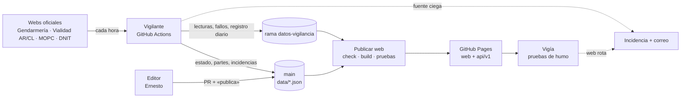

# Arquitectura

> Cómo está montado RadarCorredor: piezas, flujo de los datos, publicación y cómo trabajar con el repositorio. Qué datos hay y cómo se validan: [`datos-y-fuentes.md`](datos-y-fuentes.md). Cómo se decide el estado de un paso: [`regla-estado-pasos.md`](regla-estado-pasos.md).

## 1 · El sistema en una imagen



| Pieza | Qué hace | Dónde | Cuándo (UTC) |
|---|---|---|---|
| Vigilante | Lee las webs oficiales y publica lo que dicen, con sello «Web oficial» | `scripts/vigilante.mjs`, `vigilante.yml` | Cada hora de 06 a 21 h de Argentina, lanzado desde cron-job.org; `17 0,9-23 * * *` de respaldo (decisión 23) |
| Publicar web | Valida datos y esquemas, construye la web y `api/v1`, ejecuta las pruebas de navegador y publica solo si todo pasa | `scripts/build.mjs`, `publicar.yml` | Cada cambio en `main` y `17 */3 * * *` |
| Vigía | Comprueba la web publicada; abre y cierra su incidencia | `scripts/humo.mjs`, `vigia.yml` | Tras cada publicación y `23 */6 * * *` |
| Tareas del día | Correo al responsable con lo que necesita una persona | `scripts/tareas.mjs`, `tareas.yml` | `7 13 * * *` |
| Enlaces externos | Revisa las URL externas (informe, no bloquea) | `enlaces-externos.yml` | Lunes `41 6 * * 1` |
| Formularios | Cotizaciones, solicitudes de empresas y tiempos de cruce → Google Forms y Sheets (privado) | `data/site.json` | — |
| Analítica | GoatCounter, sin cookies | `data/site.json` → `estadisticas` | — |

## 2 · Flujo de un dato

```
Fuente oficial ──► vigilante (automático, «Web oficial») o rama con «por verificar» (manual)
      ──► data/*.json en main ──► check · build · API · enlaces · pruebas de navegador
                                     ├──► web ──► GitHub Pages ──► Vigía
                                     └──► api/v1 ──► Claude y otros sistemas
```

Nada llega a la web sin pasar las comprobaciones. Lo que entra a mano necesita la revisión del responsable editorial y su «publica» ([validación](datos-y-fuentes.md#1--validación)).

## 3 · Trabajar con el repositorio

Requisito: Node 20 o superior.

```bash
npm install              # una vez
npm run check            # esquemas JSON + reglas de contenido y calidad
npm run prueba           # genera la web y la API y comprueba coherencia y enlaces internos
npm run pruebas          # pruebas de navegador (necesita Playwright, ver pruebas/LEEME.md)
npm run dev              # genera y abre http://localhost:4321
npm run verificaciones   # verificaciones nuevas respecto a main
npm run enlaces-externos # comprueba las URL externas (informe, no bloquea)
```

Cómo editar datos, añadir fuentes, verificar y tramitar solicitudes: [`como-editar.md`](como-editar.md).

### Estructura

```
data/                Datos (fuente de verdad): pasos, rutas, incidencias, festivos, organismos,
                     directorio, novedades, fuentes… y esquemas/ (JSON Schema 2020-12)
content/guia/        Fichas de la guía en Markdown
scripts/             build (web + api/v1), check, validación, API, estimaciones, enlaces…
src/assets/          CSS y JavaScript del navegador
pruebas/             Pruebas de navegador, con datos fijos en pruebas/datos/
docs/                Documentación (mapa en el README); docs/archivo/, informes históricos
```

### API abierta

`indice.json`, `pasos.json`, `tramos.json`, `rutas.json`, `incidencias.json`, `calendario.json`, `empresas.json`, `fuentes.json`, `organismos.json`. Contrato en [`docs/ia-dev.md`](ia-dev.md); cambios en [`docs/api-cambios.md`](api-cambios.md).

### Publicación

`.github/workflows/publicar.yml`: en cada cambio en `main` (y cada 3 horas, para los tiempos de cruce) se ejecutan los trabajos `construir` y `pruebas`, y solo si los dos pasan se publica en GitHub Pages. Para pausar la publicación: variable de repositorio `PUBLICAR` = `false`. `vigilante.yml` revisa las webs oficiales cada hora, de 06 a 21 h de Argentina (prueba manual: Actions → *Vigilante de webs oficiales* → *Run workflow* con «prueba»). Los lunes, `enlaces-externos.yml` revisa las URL externas.

Este repositorio sustituye al antiguo *Red de Cargas* (rama [`legacy-red-de-cargas`](https://github.com/elezcano/GuiaCorredor/tree/legacy-red-de-cargas)).

## 4 · Fases

**Principio: lo más simple que genere ingresos.** El objetivo es un negocio con poco mantenimiento. Cada pieza técnica tiene que justificarse por ingresos o por ahorro de tiempo. Por eso la fase 1 no tiene servidor, base de datos ni cuentas de usuario.

### Fase 1 (actual)

```
 archivos de texto (content/, data/)
          │  npm run build
          ▼
    dist/  (HTML + CSS + JS)
          │  GitHub Actions
          ▼
   alojamiento estático (gratis)
```

| Necesidad | Solución en fase 1 | Coste |
|---|---|---|
| Páginas de la guía | Markdown → HTML en el build | 0 |
| Posicionamiento en Google | HTML estático, `sitemap.xml`, títulos y descripciones por página | 0 |
| Directorio y filtros | JSON incrustado + filtros en el navegador | 0 |
| Planificador | `data/rutas.json` + JavaScript en el navegador | 0 |
| Alta de empresas | Formulario de Google con hoja privada; se revisa y se añade a `directorio.json` por PR | 0 |
| Cobro de fichas destacadas | Enlace de pago de una pasarela de suscripciones (sin código) | % por cobro |
| Revisión de calidad | `npm run check` en cada cambio | 0 |

**Límite de esta fase:** a partir de unas 300–500 empresas o de muchas altas por semana, mantener el JSON a mano deja de compensar. Ese es el momento de pasar a la fase 2.

### Fase 2 (cuando haya clientes pagando)

- Base de datos gestionada (PostgreSQL) para empresas, suscripciones y documentos generados.
- Alta y edición de ficha en autoservicio, con inicio de sesión por enlace al email.
- Webhooks de la pasarela de pago: activan o desactivan la ficha destacada solos.
- Generador de CRT y MIC/DTA: formulario → PDF, pago por documento.
- Avisos de estado de pasos fronterizos por email/WhatsApp a quien se suscriba.

La guía sigue siendo estática; solo el directorio y los documentos pasan a tener servidor.
