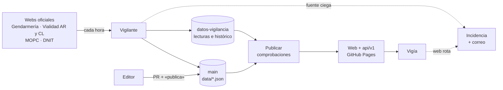

# Arquitectura

> Cómo está montado RadarCorredor y por qué. Vigente desde el 25/11/2026 · decisiones [2, 5, 18, 22, 23](decisiones.md) · qué datos hay y cómo se validan: [Datos y fuentes](datos-y-fuentes.md) · cómo se decide el estado de un paso: [Regla del estado de los pasos](regla-estado-pasos.md).

**En una frase:** una web estática que se reconstruye sola cada vez que cambia un dato, con GitHub como única fuente de verdad y nada publicado sin pasar las comprobaciones.

## Tres reglas

1. **Lo más simple que funcione.** Sin servidor, sin base de datos y sin cuentas de usuario. Cada pieza nueva tiene que justificarse por ingresos o por tiempo ahorrado.
2. **GitHub es la fuente de verdad.** Datos, código, decisiones e historial están en el repositorio: todo cambio queda en Git y se puede reconstruir.
3. **Nada se publica sin pasar las comprobaciones.** Si falla una prueba, la web sigue con la versión anterior.

## El sistema en una imagen



## Las piezas

| Pieza | Qué hace | Cuándo | Dónde |
|---|---|---|---|
| **Vigilante** | Lee las webs oficiales y publica lo que dicen con el sello «Web oficial» | Cada hora de 06 a 21 h de Argentina (lanzado desde cron-job.org; GitHub de respaldo) | `scripts/vigilante.mjs`, `vigilante.yml` |
| **Publicar** | Comprueba los datos, construye la web y `api/v1`, pasa las pruebas y publica | Cada cambio en `main` y cada 3 h | `scripts/build.mjs`, `publicar.yml` |
| **Vigía** | Abre la web publicada y comprueba que funciona; avisa si el vigilante pierde pasadas (más de 2 h sin pasar dentro de su horario) | Tras cada publicación y cada 6 h | `scripts/humo.mjs`, `vigia.yml` |
| **Tareas del día** | Correo al responsable con lo que necesita una persona | Cada día, 14:07 de España | `scripts/tareas.mjs`, `tareas.yml` |
| **Enlaces externos** | Revisa las URL externas (informa, no bloquea) | Los lunes | `enlaces-externos.yml` |
| **Trazados** | Calcula el trazado y los km de cada tramo (OpenStreetMap) y los deja en un PR | A mano | `trazados.yml` |

## Dónde vive cada dato

| Dato | Dónde | Público |
|---|---|---|
| Pasos, rutas, incidencias, festivos, organismos, directorio, fuentes | `data/*.json`, con esquemas en `data/esquemas/` | Sí (web y `api/v1`) |
| Mapa de fuentes del vigilante | `data/fuentes-vigilancia.csv` | Sí |
| Lecturas del vigilante, fallos e histórico diario | Rama `datos-vigilancia` (`vigilancia.json`) | Sí (en el repositorio) |
| Registro por ejecución: una línea por paso y pasada, 120 días (lote 3) | Rama `datos-vigilancia` (`registro/AAAA-MM-DD.jsonl`) | Sí (en el repositorio) |
| Decisiones, registro y regla | `docs/` | Sí |
| Cotizaciones, solicitudes de empresas, tiempos de cruce, prospección | Google Forms y Sheets de radarcorredor@gmail.com | **No: datos personales, nunca en el repositorio** |
| Visitas | GoatCounter, sin cookies | Agregado |

### Cómo de fiables somos

Página `/fiabilidad/` ([decisión 39](decisiones.md)). Se calcula al publicar, sin servidor, con `scripts/servicio.mjs`:

- **Cobertura:** de `vigilancia.json` → `diario` (lecturas buenas por paso y día, dentro del horario).
- **Retraso al publicar:** de `registro/*.jsonl` (lote 3), que `publicar.yml` trae a `data/vigilancia-registro/` (no se sube al repositorio). Solo con 5 partes nuevos o más.
- **Lo corregido:** la bitácora de [`regla-estado-pasos.md`](regla-estado-pasos.md#bitácora), sin copiarla.

### Solicitudes de cotización

Formulario en 3 pasos de `/cotizar/` ([decisión 37](decisiones.md)), sin servidor:

```
navegador (src/assets/cotizar.js) ─► Google Forms (22 claves) ─► hoja «Cotizaciones (respuestas)» ─► cuadro de mando
```

- **Qué se envía:** las claves de `CAMPOS_COTIZACION` (`scripts/cruces.mjs`), con su pregunta en el formulario de Google según el enlace prellenado de `site.json` → `cotizaciones`. Aduana y almacén guardan su detalle en «Algo especial» y «Peso o volumen».
- **Número de solicitud** (`RC-261125-T7J`): lo genera el navegador al enviar. «RC-», la fecha del dispositivo en `AAMMDD` y 3 caracteres al azar de un alfabeto de 32 sin I, O, 0 ni 1, para que no se confundan al dictarlos. Se envía en «Número de solicitud» y es el que ve el cliente; si reintenta tras un error, se mantiene. **No es correlativo** (no sirve para contar: eso lo hace el cuadro de mando) **ni se garantiza único**: dos solicitudes del mismo día coinciden con probabilidad 1/32.768. Un número correlativo necesitaría un servidor que lo asigne y enseñaría al cliente cuántos pedidos hay.
- **Teléfono:** prefijo elegido por país (bandera, código ISO y prefijo; se rellena con el país de origen) más el número; se guarda junto, p. ej. `+595 981 123 456`. «Otro país»: el cliente escribe el prefijo con el número.
- **Gestión, en la hoja (columnas X–AA):** «Estado», «Respondida el», «Responsable» y «Notas». Las de prueba llevan «Prueba» en Estado o empiezan por «PRUEBA» en Empresa (la prueba automática de los lunes, `prueba-cotizacion.yml`) y no cuentan en el cuadro de mando.
- **Aviso de solicitud nueva:** no hay. Se ve en la hoja o en el cuadro de mando (opción sin código: notificaciones por correo de Google Forms).

## Cómo llega un cambio a la web

```
Fuente oficial ─► vigilante («Web oficial», al momento)
                  o rama + PR («por verificar», revisión de Ernesto)
      ─► main ─► comprobaciones ─► GitHub Pages ─► Vigía
```

| Comprobación | Qué para | Bloquea |
|---|---|---|
| `npm run check` | Datos que no cumplen el esquema, fuentes que no existen, CSV del vigilante mal configurado | Sí |
| Coherencia web / `api/v1` y enlaces internos | Una página o un dato de la API que no cuadra | Sí |
| Verificaciones nuevas | Un dato marcado como verificado sin la etiqueta `revision-editorial` | Sí |
| Pruebas de navegador (`pruebas/`) | Lo que funcionaba y deja de funcionar, en móvil y en tema claro y oscuro | Sí |
| Documentación (`pruebas/documentacion.cjs`) | Un enlace o un ancla rotos, decisiones fuera de orden | Sí |
| Vigía | La web publicada no carga o le falta algo | Abre una incidencia |

Para pausar la publicación: variable del repositorio `PUBLICAR` = `false`.

## Trabajar con el repositorio

Requisito: Node 20 o superior. Cómo editar datos sin programar: [Cómo editar](como-editar.md).

```bash
npm install              # una vez
npm run dev              # genera la web y la abre en http://localhost:4321
npm run check            # esquemas y reglas de contenido
npm run prueba           # web + API + coherencia y enlaces internos
npm run pruebas          # pruebas de navegador (Playwright, ver pruebas/LEEME.md)
npm run verificaciones   # verificaciones nuevas respecto a main
npm run enlaces-externos # URL externas (informe)
```

```
data/          Datos y esquemas: la fuente de verdad
content/guia/  Fichas de la guía (Markdown)
scripts/       Construcción, comprobaciones, vigilante, API
src/assets/    CSS y JavaScript del navegador
pruebas/       Pruebas, con datos y reloj fijos (pruebas/datos/)
docs/          Documentación (mapa en el README); docs/archivo/, lo histórico
```

**API abierta** (`/api/v1/`): `indice`, `pasos`, `tramos`, `rutas`, `incidencias`, `calendario`, `empresas`, `fuentes` y `organismos`, en JSON. Contrato en [`ia-dev.md`](ia-dev.md); cambios en [`api-cambios.md`](api-cambios.md). Un cambio de formato se avisa y la versión anterior se mantiene 6 meses (decisión 13).

## Qué cuesta

| Necesidad | Cómo se resuelve hoy | Coste |
|---|---|---|
| Web, guía, planificador, directorio | HTML estático generado; filtros en el navegador | 0 |
| Alojamiento y automatización | GitHub Pages y GitHub Actions | 0 |
| Vigilancia horaria | GitHub Actions + cron-job.org | 0 |
| Formularios | Google Forms y Sheets | 0 |
| Estadísticas | GoatCounter | 0 |
| Cobro de fichas destacadas | Enlace de pago de una pasarela, sin código | % por cobro |

## Cuándo cambiar de arquitectura

La fase actual llega hasta unas 300–500 empresas o muchas altas por semana: ahí mantener el JSON a mano deja de compensar. Entonces, y solo con clientes pagando:

- Base de datos gestionada para empresas, suscripciones y documentos.
- Alta y edición de ficha por la propia empresa, con acceso por enlace al correo.
- Activación automática de la ficha destacada con el pago.
- Generador de CRT y MIC/DTA, con pago por documento.
- Avisos de cambio de estado por correo o WhatsApp.

La guía y el estado de los pasos siguen siendo estáticos.

## Límites conocidos

| Límite | Qué lo mitiga |
|---|---|
| `main` no está protegida mientras la web sea un borrador (decisión 14) | Las comprobaciones bloquean la publicación; se protegerá antes del lanzamiento (#49) |
| El cron de GitHub puede llegar con retraso | cron-job.org lanza el vigilante; una lectura vale 6 h |
| Dependemos del formato de webs oficiales | Autopruebas con páginas reales y aviso a los 3 fallos seguidos |
| Una sola persona verifica y publica | Todo queda en Git y en el registro; la IA propone, no verifica |

Historia: este repositorio sustituye al antiguo *Red de Cargas* (rama [`legacy-red-de-cargas`](https://github.com/elezcano/GuiaCorredor/tree/legacy-red-de-cargas)).
