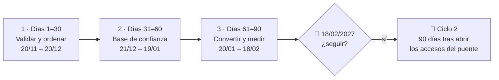

# Plan de 90 días

> Qué hacemos hasta la decisión del 18/02/2027 y en qué orden (decisión 27). El seguimiento diario está en Trello; lo publicado, en [`registro.md`](registro.md).

**Veredicto del comité (20/11/2026): CONTINUAR · 8/10.** Un ciclo de validación de 90 días sin crecer en amplitud. El núcleo: **fronteras y aduanas fiables, empresas verificadas y cotizaciones que reciban respuesta.** Ninguna funcionalidad nueva sin evidencia de uso.

Las tarjetas de Trello llevan el número de su fase (por ejemplo, **2.1**) y la issue entre paréntesis.

| Fase | Tarjetas |
|

## Próximos pasos

Ahora: **0.1** terminar la red de Santos a Iquique, **1.6** estadísticas, **1.7** ficha de empresa verificada y, por parte de Ernesto, **1.1** reservar la entrevista con la responsable de flota.

Plan completo por fases: [P0](https://github.com/elezcano/GuiaCorredor/issues?q=label%3AP0) · [P1](https://github.com/elezcano/GuiaCorredor/issues?q=label%3AP1) · [P2](https://github.com/elezcano/GuiaCorredor/issues?q=label%3AP2) · [P3](https://github.com/elezcano/GuiaCorredor/issues?q=label%3AP3).

## Antes del lanzamiento

- [x] Email de contacto del proyecto
- [x] Formulario de Google de solicitudes de empresas
- [x] Ninguna empresa ficticia en el directorio
- [x] Pruebas automáticas antes de cada publicación (#50)
- [ ] Primeras empresas reales verificadas (#46)
- [ ] Revisión de las fichas de la guía (#22)
- [ ] Enlace de suscripción de PayPal de la ficha destacada (#17)
- [ ] Aviso legal y privacidad (#48)
- [ ] Dominio (#16) e `"indexable": true` en `data/site.json`
