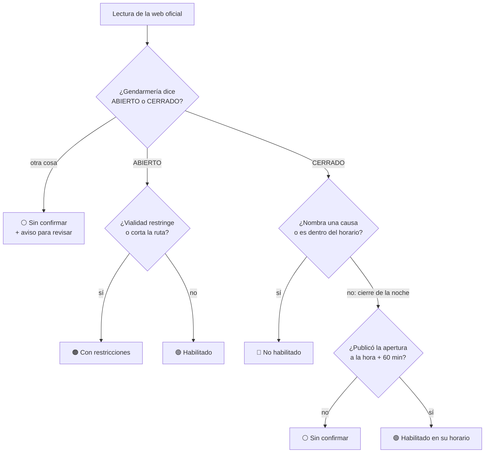

# Regla del estado de los pasos

> Cómo decide RadarCorredor si un paso fronterizo está habilitado. Vigente desde el 25/11/2026 (versión 1.2) · decisiones [31 a 34](decisiones.md) · si el código y este documento no coinciden, es un fallo y se corrigen los dos en el mismo PR.

**Por qué importa.** Un falso «Habilitado» manda un camión a 4.200 m a encontrarse la barrera bajada. Un falso «Sin confirmar» le cuesta una llamada. Los dos errores no cuestan lo mismo, y la regla está hecha para no cometer el primero.

## Tres reglas

1. **Cada lado del paso lo decide su país**, con su fuente oficial.
2. **El silencio se lee según cómo informa ese país.** Si avisa cada día de que abre, callar no vale. Si solo avisa cuando cierra, callar significa abierto. Si no tiene canal oficial, su lado no cuenta y se dice.
3. **El cruce muestra el peor de sus lados.** Y la duda sale como «Sin confirmar», nunca como abierto ni como cerrado.

## Los cuatro estados

| Estado | Significa | Cuándo |
|---|---|---|
| 🟢 **Habilitado** | Se puede cruzar en su horario | Todos los lados que cuentan lo confirman y el acceso no tiene avisos |
| 🟠 **Con restricciones** | Se cruza, con limitaciones | Vialidad restringe o corta la ruta, o hay un aviso oficial en la carretera de acceso |
| 🔴 **No habilitado** | No se puede cruzar | Un organismo oficial lo cierra, o el puente está en obras |
| ⚪ **Sin confirmar** | Hoy no lo sabemos | Falta la confirmación de un lado, o la fuente publica algo que no sabemos interpretar |

El horario va aparte: «Fuera de horario · abre a las 09:00» informa, no cierra.

## Cómo informa cada país

| País | Fuente | Cómo informa | Su lado vale si… |
|---|---|---|---|
| 🇦🇷 Argentina | Gendarmería y Vialidad Nacional (web del Ministerio de Seguridad), leídas solas cada hora | Publica cada mañana que abre | La leímos hace menos de 6 h, o hay parte oficial de hoy |
| 🇨🇱 Chile | Unidad de Pasos Fronterizos (cuenta en X), revisada a mano | Solo avisa cuando cierra | No hay aviso de cierre y el canal se revisó en los últimos 15 días |
| 🇵🇾 Paraguay | Ninguna: ni Migraciones, ni DNIT, ni MOPC publican el estado de los pasos (revisado el 25/11/2026) | — | No cuenta: decide el otro lado y la ficha dice «Sin canal oficial» |
| 🇧🇷 Brasil | — | — | Puente Bioceánico en obras: «No habilitado» hasta su apertura (~feb. 2027) |

| Cruce | Lados | Quién decide hoy |
|---|---|---|
| Jama y Sico | Argentina + Chile | Gendarmería, salvo aviso de cierre de Chile o aviso en el acceso |
| Misión La Paz – Pozo Hondo | Argentina + Paraguay | Gendarmería |
| Puente Bioceánico | Paraguay + Brasil | Fijo: en obras |

## Cómo se decide

### Lado argentino: lo decide el vigilante cada hora

| ID | Regla | Ejemplo real |
|---|---|---|
| **D0** | Solo «ABIERTO» y «CERRADO» deciden. Otro valor → Sin confirmar, y cuenta como lectura fallida | Un «CONDICIONADO» nunca se lee como abierto |
| **D1** | Un «Motivo del cierre» cuenta si **nombra una causa** (nieve, viento, paro, avería…) o, sin causa, si se publicó **dentro del horario** | El parte de Chile «222000NOV26 … permanece cerrado» (22/11, 20:00) no es motivo: es el cierre de cada noche |
| **D2** | «CERRADO» es un cierre si no hay horario publicado, si hay motivo (D1) o si el parte es de dentro del horario | Sico, 24/11, «Cerrado» a las 18:13 con horario hasta las 19:00 → No habilitado |
| **D3** | Cierre de la noche: si a la apertura + 60 min Gendarmería no ha publicado nada nuevo → Sin confirmar. Antes de esa hora se mira la apertura de ayer | Jama, 24/11 a las 08:30, último parte del 22/11 → Sin confirmar |
| **D4** | «ABIERTO» con Vialidad RESTRINGIDA o CORTE TOTAL → Con restricciones (el corte total, por decisión del fundador) | — |

El vigilante solo reabre lo que cerró él; si contradice un dato cargado a mano, avisa y no lo toca. Si dio por cierre algo que con esta regla es el de la noche, lo corrige solo.

### El cruce: lo combina la web al publicarse

| ID | Si… | Se muestra |
|---|---|---|
| **D5** | Un lado que cuenta no vale (ver la tabla de países) | ⚪ Sin confirmar · «falta confirmación de …» |
| **D6** | Chile publicó un aviso de cierre o restricción en los últimos 15 días | Ese estado · «Chile: aviso oficial del …» |
| **D6** | Hay un aviso oficial, leído solo, ámbar o rojo, en la carretera de acceso de cualquier lado | 🟠 Con restricciones · «aviso en el acceso» |
| **D6** | La web oficial no responde y el último estado era No habilitado o Con restricciones | Ese estado · «la web oficial no responde desde …: es el último estado leído» |
| **D6** | El estado no está verificado, tiene más de 30 días (120 si está cerrado) o viene de prensa | ⚪ Sin confirmar |
| — | Todo lo demás confirma | 🟢 Habilitado (con «Chile: sin avisos desde…» si aplica) |

## Histórico de 30 y 90 días

- Un registro por paso y día con su **peor estado**: cerrado > sin paso para carga > restricciones > abierto.
- Solo cuentan lecturas **dentro del horario**, de **fuente oficial** y con **parte de Gendarmería de ese mismo día**.
- Un día sin lecturas válidas es **«sin datos»**: nunca hereda el anterior.
- Se guarda 120 días. Un día mal registrado se corrige una sola vez, y queda anotado (`CORRECCIONES_DIARIO`).
- El Puente Bioceánico no tiene histórico: se medirá desde que abra.

## Si algo falla

| Qué pasa | Qué ve el usuario | Qué hacemos |
|---|---|---|
| Gendarmería no publica la apertura | ⚪ Sin confirmar | Nada: se resuelve cuando publique. El día queda «sin datos» |
| Gendarmería publica un valor nuevo | ⚪ Sin confirmar | Incidencia a los 3 fallos; añadir el valor a la regla con su prueba |
| La web oficial no responde | Habilitado: a las 6 h, Sin confirmar. Cerrado o con restricciones: se mantiene, avisando | Incidencia y correo a los 3 fallos seguidos |
| Chile avisa de un cierre | 🔴 No habilitado · «Chile: aviso oficial del …» | Cargar el parte de Chile (PR) |
| Nadie revisa el canal de Chile en 15 días | ⚪ Sin confirmar, con enlace al canal | Revisarlo y actualizar `revisado` |
| El vigilante no corre | A las 6 h, Sin confirmar | Lanzarlo a mano y revisar Actions |

## Principios que el código debe cumplir siempre

Cada uno tiene al menos una prueba.

1. **INV-1** Solo una fuente oficial decide un estado.
2. **INV-2** Un cierre solo es cierre si un organismo oficial lo dice dentro del horario o con una causa.
3. **INV-3** El silencio se lee según cómo informa cada país.
4. **INV-4** La duda sale como «Sin confirmar». No existe «probablemente».
5. **INV-5** El cruce es el peor de los lados que cuentan.
6. **INV-6** El horario no es un estado.
7. **INV-7** El histórico solo registra lo que un organismo oficial publicó ese día.
8. **INV-8** Todo estado dice de dónde sale y cuándo.
9. **INV-9** Lo que cargó una persona no lo pisa la máquina en silencio.
10. **INV-10** Un valor oficial que no reconocemos nunca se lee como abierto.
11. **INV-11** Cualquier lado puede empeorar el cruce.

## Parámetros

| Qué | Valor | Dónde se cambia |
|---|---|---|
| Margen de apertura | 60 min | `scripts/vigilante.mjs` → `MARGEN_APERTURA_MIN` |
| Valores de Gendarmería que deciden | ABIERTO, CERRADO | `scripts/vigilante.mjs` → `ESTADOS_GENDARMERIA` |
| Palabras que cuentan como causa | lista | `scripts/vigilante.mjs` → `CAUSA` |
| Vida de una lectura automática | 6 h | `scripts/build.mjs` → `LECTURA_LADO_H` |
| Modo y plazo de cada país | Chile: por aviso, 15 días · Paraguay: sin canal | `data/site.json` → `canalesParte` |
| Caducidad de un estado | 30 días (abierto) · 120 (cerrado) | `scripts/validacion.mjs` → `CADUCIDAD` |
| Fallos seguidos para avisar | 3 | `scripts/vigilante.mjs` → `FALLOS_PARA_AVISAR` |

Pruebas: `node scripts/vigilante.mjs --autoprueba` (lado argentino) y `pruebas/lados.cjs`, `pruebas/integridad.cjs`, `pruebas/fiabilidad.cjs` (web).

## Riesgos conocidos

| Riesgo | Qué lo mitiga |
|---|---|
| Dependemos del formato de la web oficial argentina | Lista de valores válidos (D0), lectura fallida y aviso; autoprueba con páginas reales |
| Chile se revisa a mano | A los 15 días sin revisar, Sin confirmar con enlace al canal |
| Paraguay no tiene canal oficial | Se dice en la ficha; si aparece uno, pasa a «por aviso» |
| El corte total sale en ámbar (decisión del fundador) | El texto dice «corte total según Vialidad Nacional» |
| Con la fuente caída, un «Cerrado» puede seguir aunque el paso reabra (decisión del fundador) | Se dice en la ficha y en el tablero; incidencia a los 3 fallos |
| Una causa nueva no prevista en `CAUSA`, fuera de horario, se tomaría por rutinaria | Revisar cada mes los «Motivo del cierre» y ampliar la lista |
| El vigilante no lee de 21:17 a 06:17 (hora de Argentina) | Los pasos están cerrados de noche; la primera lectura es antes de abrir |

## Cambiar la regla

En un solo PR:

1. El **caso real** que lo motiva (fecha, paso y el texto o la captura oficial).
2. La **decisión** en [`decisiones.md`](decisiones.md).
3. Este documento, con su fila en la **bitácora**.
4. El **código** y su **prueba**.
5. La **corrección de datos**, si el error dejó huella.
6. Tras publicar: su fila en el [registro](registro.md) y la comprobación de «Publicar web» y «Vigía».

## Bitácora

| Fecha | Qué pasó | Qué se decidió | PR |
|---|---|---|---|
| 20/11/2026 | Pasos «abiertos» con un solo lado confirmado | Todos los lados deben confirmar (decisión 29, sustituida por la 33) | #216 |
| 22/11/2026 | Chile no publica a diario: solo avisa | Lado «por aviso», con plazo de 15 días (decisión 31) | #228 |
| 17–19/11/2026 | Los cierres de cada noche se registraban como cierres | Un «Cerrado» fuera de horario y sin motivo es el cierre de la jornada (decisión 32) | #244 |
| 22/11/2026 | La web oficial mete en «Motivo del cierre» el parte de Chile de las 20:00 | Sin causa y fuera de horario no es motivo | #248 |
| 23/11/2026 | Gendarmería no publicó en todo el día en Jama ni en Sico | El histórico exige parte del día; el 23/11 queda «sin datos» | #248 |
| 24/11/2026 | A las 08:30, Jama salía «Abierto» con el último parte del 22/11 | Se exige la apertura de ayer si aún no llegó la de hoy | #257 |
| 24/11/2026 | La regla era difícil de explicar (48 h, «Abierto solo en…») | Regla por país en tres líneas (decisión 33) | #257 |
| 25/11/2026 | Paraguay no tiene canal oficial | Su lado no cuenta y se dice | #257 |
| 25/11/2026 | Auditoría: un valor desconocido se leía como abierto; un cierre de Chile salía «Sin confirmar» | Lista de valores válidos; el aviso de cierre de un lado decide el cruce (decisión 34) | #265 |
| 25/11/2026 | El fundador decide: el temporal o la carretera de cualquier lado afectan al cruce; el corte total sigue en ámbar; con la fuente caída se mantiene el último estado | Aviso en el acceso → Con restricciones; aviso de fuente caída (decisión 34) | #265 |
| 25/11/2026 | El documento era largo y difícil de leer | Misma regla, presentada en la mitad de espacio (versión 1.2) | #272 |
