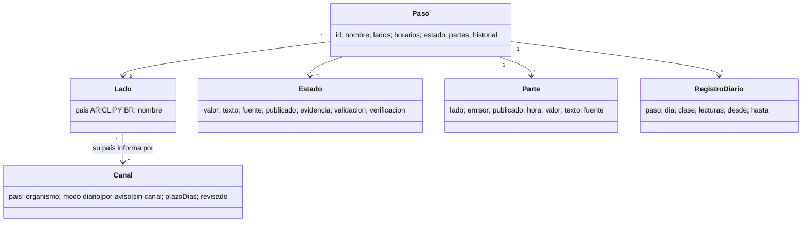
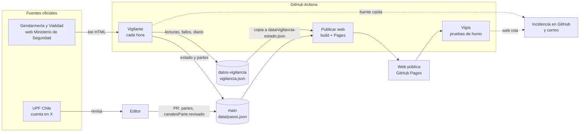
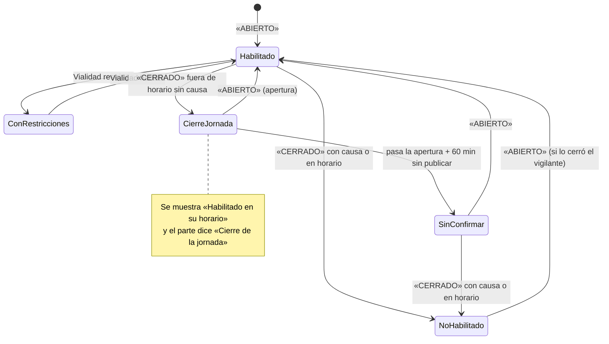

# Estado de los pasos fronterizos: regla de negocio y arquitectura

| | |
|---|---|
| **Documento** | Especificación de referencia del estado de los pasos (qué decimos, con qué fuente y cómo lo calculamos) |
| **Ámbito** | Jama, Sico, Misión La Paz–Pozo Hondo y Puente Bioceánico |
| **Estado** | Vigente |
| **Versión** | 1.0, 25/11/2026 |
| **Decisiones que recoge** | 31, 32 y 33 del README (sustituyen a la 29 y la 30) |
| **Código** | `scripts/vigilante.mjs` (`decidir`, `motivoReal`, `aperturaExigible`, `cuentaEnDiario`), `scripts/build.mjs` (`estadoPaso`, `ladosSinParte`, `ladosHTML`), `scripts/validacion.mjs` (`estadoMostrable`, `CADUCIDAD`) |
| **Configuración** | `data/site.json` → `canalesParte`; `data/fuentes-vigilancia.csv` |
| **Pruebas** | `node scripts/vigilante.mjs --autoprueba`; `pruebas/lados.cjs`, `pruebas/partes.cjs`, `pruebas/fiabilidad.cjs` |

> **Regla de mantenimiento.** Si el código y este documento no coinciden, es un fallo. Se corrigen los dos en el mismo PR, junto con su prueba y su fila en las decisiones del README.

---

## 1. Para qué existe

El estado de un paso es el dato con el que un transportista decide si sale o no. Un falso «Habilitado» manda un camión a 4.200 m a encontrarse la barrera bajada: pierde el día y nosotros perdemos la confianza. Un falso «Sin confirmar» le cuesta una llamada. **Los dos errores no cuestan lo mismo, y toda la regla está construida sobre esa asimetría.**

Decisiones que soporta, por actor:

| Actor | Pregunta | Qué necesita de nosotros |
|---|---|---|
| Transportista / chofer | ¿Salgo hoy hacia el paso? | Estado de hoy, horario, y si hay duda, a quién llamar |
| Empresa de transporte / despachante | ¿Planifico esta semana por este paso? | Estado de hoy y fiabilidad de 30/90 días |
| Cargador / cliente | ¿Cumple el plazo de entrega? | Fiabilidad del paso y del tramo |
| Editor de RadarCorredor | ¿Qué tengo que revisar hoy? | Qué lado no confirma y por qué |

## 2. Principios (invariantes)

Toda versión del código debe cumplirlos. Cada uno tiene al menos una prueba.

| ID | Principio |
|---|---|
| **INV-1** | **Solo una fuente oficial decide un estado.** La prensa y los terceros dan contexto: con ellos el estado sale «Sin confirmar», nunca «Habilitado» ni «No habilitado». |
| **INV-2** | **Un cierre solo es un cierre si lo dice un organismo oficial, dentro del horario o nombrando una causa.** El cierre de cada noche no es un cierre. |
| **INV-3** | **El silencio se interpreta según cómo informa cada país.** Si avisa cada día de que abre, su silencio no vale. Si solo avisa cuando cierra, su silencio vale como habilitado, dentro de un plazo de revisión. Si no tiene canal oficial, su lado no cuenta y se dice. |
| **INV-4** | **La duda sale como «Sin confirmar».** Nunca como «Habilitado» ni como «No habilitado». No existe «probablemente». |
| **INV-5** | **El cruce es el peor de los lados que cuentan.** «Habilitado» exige que todos lo confirmen. |
| **INV-6** | **El horario no es un estado.** «Fuera de horario · abre en…» informa, no cierra. |
| **INV-7** | **El histórico solo registra lo que un organismo oficial publicó ese día.** Un día sin publicación es «sin datos» y nunca hereda el anterior. |
| **INV-8** | **Todo estado dice de dónde sale y cuándo**: organismo, fecha y hora del parte, y cuándo lo leímos. |
| **INV-9** | **Lo que cargó una persona no lo pisa la máquina en silencio.** El vigilante solo reabre lo que él mismo cerró; si contradice un dato manual, avisa. |

## 3. Modelo de dominio



| Término | Definición | Dónde vive |
|---|---|---|
| **Paso** | Cruce fronterizo con dos lados | `data/pasos.json` |
| **Lado** | La mitad de un paso que controla un país | `pasos[].lados` |
| **Estado** | Lo que decimos del paso ahora: `operativo`, `restricciones`, `cerrado`, `pendiente`, `en-obras` | `pasos[].estado` |
| **Parte** | Publicación de un organismo sobre un lado, con fecha y hora | `pasos[].partes` |
| **Evidencia** | Tipo de fuente: `oficial`, `tercero`, `declaracion-empresa`… Solo `oficial` decide (INV-1) | `estado.evidencia` |
| **Verificación** | Quién lo comprobó (`vigilante` o persona), cuándo y cómo | `estado.verificacion` |
| **Canal** | Cómo informa un país: `diario`, `por-aviso` o `sin-canal` | `site.canalesParte` |
| **Motivo real** | Texto de «Motivo del cierre» que nombra una causa, o que sin causa se emitió dentro del horario | `motivoReal()` |
| **Apertura exigible** | Último momento en que la apertura ya debía estar publicada: apertura + 60 min de hoy, o de ayer si aún no llegó esa hora | `aperturaExigible()` |
| **Registro diario** | Peor estado oficial del día, para el histórico 30/90 | rama `datos-vigilancia` → `vigilancia.json` → `diario` |

Correspondencia entre el valor interno y lo que ve el usuario:

| `estado.valor` | Web (es) | Color |
|---|---|---|
| `operativo` | Habilitado / Abierto | Verde |
| `restricciones` | Habilitado con restricciones | Ámbar |
| `cerrado`, `en-obras` | No habilitado / Cerrado / En obras | Rojo |
| `pendiente` | Sin confirmar | Gris |

## 4. Fuentes por país

| País | Organismo y canal | Cómo informa | Modo | Lectura | Calidad |
|---|---|---|---|---|---|
| Argentina | Gendarmería Nacional (estado y horario) y Vialidad Nacional (ruta), web del Ministerio de Seguridad, una página por paso | Publica cada mañana la apertura, y los cierres y avisos («Atención», «Motivo del cierre») | `diario` (por defecto) | Automática, cada hora (vigilante) | Alta. Pegas: a veces no publica en todo el día (23/11) y mete en «Motivo del cierre» el parte rutinario de Chile (22/11) |
| Chile | Unidad de Pasos Fronterizos (UPF), cuenta oficial en X | Solo cuando hay un problema | `por-aviso`, 15 días | Manual: se revisa el canal y se anota `revisado` | Media: sin web ni API; los avisos llegan también por WhatsApp |
| Paraguay | **Ninguno** (revisado el 25/11/2026: ni Migraciones, sin ficha por paso; ni DNIT; ni MOPC, que informa de la ruta PY15, no del paso) | — | `sin-canal` | — | — |
| Brasil | — (Puente Bioceánico en obras, apertura prevista ~feb. 2027) | — | — | — | — |

Cruces y lados:

| Cruce | Lado A | Lado B | Quién decide hoy |
|---|---|---|---|
| Jama | AR (diario) | CL (por aviso) | Gendarmería, salvo aviso de cierre de la UPF |
| Sico | AR (diario) | CL (por aviso) | Ídem |
| Misión La Paz–Pozo Hondo | AR (diario) | PY (sin canal) | Gendarmería; la ficha dice que Paraguay no tiene canal |
| Puente Bioceánico | PY | BR | Fijo: en obras |

## 5. Arquitectura



| Componente | Responsabilidad | Escribe en | Disparador (UTC) |
|---|---|---|---|
| **Vigilante** (`vigilante.yml`, `scripts/vigilante.mjs`) | Lee la web oficial, decide el estado del lado argentino y lleva el registro diario | `main` (`data/pasos.json`) y rama `datos-vigilancia` | `17 0,9-23 * * *`: de 06:17 a 21:17 (hora de Argentina), cada hora; también a mano |
| **Publicar web** (`publicar.yml`, `scripts/build.mjs`) | Combina estado, lados, canales y caducidad, y genera la web | GitHub Pages | Cada push a `main`, y `17 */3 * * *` |
| **Vigía** (`vigia.yml`, `scripts/humo.mjs`) | Comprueba la web publicada | Abre y cierra la incidencia «Vigía: la web publicada tiene fallos» | Tras cada publicación correcta, y `23 */6 * * *` |
| **Editor** | Revisa los canales sin lectura automática (UPF), carga partes y corrige | PR a `main` | Diario |

Separación de responsabilidades:

- **El vigilante decide el estado del lado argentino.** Es el único sitio con lógica de horarios y motivos.
- **La web combina los lados.** Aplica el modo de cada país, la caducidad y el peor de los lados. No reinterpreta lo que leyó el vigilante.
- **El histórico** sale solo del registro diario del vigilante (`scripts/fiabilidad.mjs`).

## 6. Regla

### 6.1 En tres líneas

1. **Cada lado lo decide su país**, con su fuente oficial.
2. **Según cómo informa su país:** si avisa cada día de que abre, su silencio no vale; si solo avisa cuando cierra, su silencio significa abierto; si no tiene canal oficial, ese lado no cuenta y se dice.
3. **El cruce es el peor de los lados que cuentan.** Un cierre o una restricción oficial se muestra tal cual; «Habilitado» solo si todos los lados que cuentan lo confirman.

### 6.2 Lado argentino (vigilante)



Tablas de decisión (en orden):

**D1 · ¿El texto de «Motivo del cierre» es un motivo real?** (`motivoReal`)

| Nombra una causa (`CAUSA`: nieve, viento, temporal, accidente, paro, piquete, avería, sistema, obra…) | Hora de emisión (grupo fecha-hora `DDHHMM MES AA`; si no lo trae, hora del parte) | Resultado |
|---|---|---|
| Sí | cualquiera | Motivo real |
| No | dentro del horario | Motivo real |
| No | fuera del horario | **No es motivo** (parte rutinario de cierre) |
| No | desconocida | Motivo real (no podemos descartarlo) |

**D2 · Gendarmería marca «CERRADO»: ¿es un cierre?**

| Sin horario publicado | Motivo real (D1) | Parte publicado dentro del horario | Resultado |
|---|---|---|---|
| Sí | — | — | Cierre → **No habilitado** |
| — | Sí | — | Cierre → **No habilitado** |
| — | — | Sí | Cierre → **No habilitado** |
| No | No | No | Cierre de la jornada → D3 |

**D3 · Cierre de la jornada: ¿se publicó la apertura?** (`aperturaExigible`)

| Último parte de Gendarmería | Resultado |
|---|---|
| Anterior a la apertura exigible | **Sin confirmar** («no ha publicado la apertura desde entonces») |
| Igual o posterior | **Habilitado en su horario**; parte «Cierre de la jornada» |

Ejemplo con horario 09:00–19:15: el 24/11 a las 08:30 la apertura exigible es el 23/11 a las 10:00; a las 10:30, el 24/11 a las 10:00.

**D4 · Gendarmería marca «ABIERTO»**

| Vialidad | Resultado |
|---|---|
| RESTRINGIDA o CORTE TOTAL | **Habilitado con restricciones** |
| Otro | **Habilitado** |

Solo reabre un estado que cerró el propio vigilante (INV-9). Un falso cierre del vigilante que con la regla vigente es el de la noche se corrige solo en la siguiente pasada, junto con su parte.

### 6.3 La web: lados y cruce (`estadoPaso`)

**D5 · ¿Vale el lado?** (`ladosSinParte`)

| Modo del país | El lado vale si… | Si no vale, la ficha dice |
|---|---|---|
| `diario` (AR) | lectura automática de su web oficial hace < 6 h (`LECTURA_LADO_H`) **o** parte oficial de ese lado fechado hoy | «Sin confirmar · sin parte de hoy ni lectura de su web oficial en las últimas 6 h» |
| `por-aviso` (CL) | su último parte no es un cierre **y** el canal se revisó (o hubo parte) en los últimos `plazoDias` (15) | «Sin confirmar · su canal oficial no se ha revisado en los últimos 15 días», con enlace |
| `sin-canal` (PY) | no cuenta | «Sin canal oficial · Paraguay no publica el estado de sus pasos: manda el otro lado» |

**D6 · ¿Qué se muestra del cruce?** (en orden; la primera que se cumple)

| # | Condición | Se muestra |
|---|---|---|
| 1 | Estado sin verificar o caducado (`CADUCIDAD`: 30 días si está abierto o con restricciones; 120 si está cerrado o en obras) | Sin confirmar |
| 2 | Estado `cerrado`, `restricciones`, `pendiente`, `en-obras` | Tal cual |
| 3 | Estado `operativo` con evidencia no oficial | Sin confirmar |
| 4 | Estado `operativo` y algún lado que cuenta no vale (D5) | Sin confirmar · falta confirmación de … |
| 5 | Estado `operativo` y todos los lados que cuentan valen | **Habilitado** (con «Chile: sin avisos desde…» si aplica) |

### 6.4 Pseudocódigo completo

```text
# ─ VIGILANTE: cada hora, por paso con lado argentino ─
lectura ← leer(web Ministerio de Seguridad)
si falla o no trae estado:            no tocar nada; contar fallo (aviso a los 3 seguidos)
si lectura más antigua que lo cargado: no tocar nada

si Gendarmería = CERRADO:
    motivo ← motivoReal(«Motivo del cierre», horario, hora del parte)          # D1
    si sinHorario o motivo o entre(hora del parte, horario):                     # D2
        estado ← No habilitado (cita el motivo si lo hay)
    si no:
        si parteGendarmería < aperturaExigible(horario, ahora): estado ← Sin confirmar   # D3
        si no: estado ← Habilitado en su horario; parte ← «Cierre de la jornada»
si no:                                                                            # D4
    estado ← Vialidad restringe ? Con restricciones : Habilitado
    (solo reabre lo que cerró el vigilante)

registro diario: si dentro del horario y evidencia oficial y parteGendarmería.dia = hoy:
    diario[paso][hoy] ← peor(diario[paso][hoy], estado)

# ─ WEB: al construir, por paso ─
e ← estadoMostrable(estado)                       # caducidad
si e no confirmado o e ≠ operativo: mostrar e     # D6.1–2
si e.evidencia ≠ oficial: mostrar Sin confirmar    # D6.3
faltan ← [lado | modo(lado) ≠ sin-canal y no vale(lado)]   # D5
si faltan: mostrar Sin confirmar · falta confirmación de faltan    # D6.4
si no: mostrar Habilitado                                          # D6.5
```

## 7. Histórico 30/90 días

| Regla | Detalle |
|---|---|
| Qué se apunta | Una entrada por paso y día: peor clase, número de lecturas, primera y última hora |
| Qué cuenta | Lecturas **dentro del horario**, con **evidencia oficial** y **parte de Gendarmería de ese mismo día** (`cuentaEnDiario`) |
| Peor clase | cerrado > sin paso para carga > restricciones > abierto |
| Día sin lecturas válidas | «Sin datos». Nunca hereda el día anterior |
| Retención | 120 días |
| Arranque | Semilla reconstruida del historial (`data/diario-pasos-semilla.json`) |
| Correcciones | `CORRECCIONES_DIARIO` en el vigilante: borra un día una sola vez, queda anotada en `correccionesDiario` y las lecturas siguientes lo rehacen |
| Pasos sin lado argentino | Sin registro (Puente Bioceánico: «Aún no habilitado: la fiabilidad se medirá desde que abra») |

## 8. Parámetros

| Parámetro | Valor | Dónde | Por qué |
|---|---|---|---|
| Margen de apertura | 60 min | `vigilante.mjs` → `MARGEN_APERTURA_MIN` | Gendarmería suele publicar entre la apertura y unos 30 min después |
| Palabras de causa | lista `CAUSA` | `vigilante.mjs` | Distinguir un cierre real del parte rutinario |
| Antigüedad de lectura automática | 6 h | `build.mjs` → `LECTURA_LADO_H` | Cubre una o dos pasadas perdidas del vigilante |
| Plazo de un canal por aviso | 15 días | `site.json` → `canalesParte.<país>.plazoDias` | Revisión semanal con margen |
| Caducidad del estado | 30 / 120 días | `validacion.mjs` → `CADUCIDAD` | Un estado sin revisar no se presenta como actual |
| Fallos seguidos para avisar | 3 (DNIT: 6) | `vigilante.mjs` → `FALLOS_PARA_AVISAR`, `FALLOS_POR_FUENTE` | Evitar falsas alarmas por cortes breves |
| Reintentos de lectura | 10 s y 30 s | `vigilante.mjs` → `ESPERAS_REINTENTO` | Errores de red y 5xx transitorios |
| Retención del registro diario | 120 días | `actualizarDiario` | Cubre los 90 días del histórico |

## 9. Modos de fallo y respuesta

| Situación | Detección | Qué ve el usuario | Qué hacemos |
|---|---|---|---|
| Gendarmería no publica la apertura | D3 | Sin confirmar | Nada; se resuelve cuando publique. Día «sin datos» |
| Parte rutinario de cierre en «Motivo del cierre» | D1 | Habilitado en su horario | Nada (caso del 22/11) |
| La web oficial no responde | Fallo de lectura | Lo último leído; a las 6 h, ese lado pasa a Sin confirmar | Incidencia y correo a los 3 fallos seguidos |
| La web oficial cambia el formato | Lectura sin estado | Ídem | Incidencia; adaptar el lector y su autoprueba |
| Aviso de cierre de la UPF | Revisión del editor | No habilitado | Cargar el parte y el estado (PR) |
| Nadie revisa el canal de Chile en 15 días | D5 | Sin confirmar, con enlace al canal | Revisar y actualizar `revisado` |
| El vigilante no corre (Actions caído) | Sin commits ni datos nuevos | A las 6 h, Sin confirmar | Lanzarlo a mano; revisar Actions |
| Falla la publicación | Vigía no se lanza / falla | La versión anterior | Incidencia del Vigía |
| Un dato manual contradice la lectura | Vigilante | El dato manual | El vigilante avisa y no lo pisa (INV-9) |
| Error ya registrado en el histórico | Revisión | Histórico erróneo | `CORRECCIONES_DIARIO` + PR |

## 10. Calidad

- **Autoprueba del vigilante** (CI): casos reales de cada decisión. Entre otros: el parte de Chile del 22/11, la apertura no publicada antes y después de las 10:00, el motivo con causa, la corrección del registro diario, el registro que exige parte del día.
- **Pruebas de navegador** (15, fecha fija 15/11/2026): una línea por lado, Chile por aviso, Paraguay sin canal, que no aparezca «Abierto solo en», horario aparte del estado, histórico.
- **Vigía** sobre la web publicada.
- **Puertas de CI**: `construir`, `pruebas` y `vigilar` en verde antes de fusionar; se publica solo con «publica» del responsable.

## 11. Gobierno del cambio

Cualquier cambio de esta regla sigue este orden, en un solo PR:

1. **Caso real** que lo motiva (fecha, paso, captura o texto oficial).
2. **Decisión** nueva o modificada en el README, con fecha.
3. **Este documento**: invariante, tabla de decisión o parámetro afectado, y fila en la bitácora (§13).
4. **Código** y su **prueba** (autoprueba o navegador).
5. **Corrección de datos** si el error dejó huella (estado, parte o `CORRECCIONES_DIARIO`).
6. Tras publicar: registro en el README y comprobación de «Publicar web» y «Vigía».

Para añadir un país o un canal basta con una entrada en `canalesParte` con su `modo` y, si es `por-aviso`, `plazoDias` y `revisado`. Si el canal tiene lectura automática, una fila en `data/fuentes-vigilancia.csv` y su lector en el vigilante.

## 12. Riesgos y deuda conocida

| Riesgo | Impacto | Mitigación / plan |
|---|---|---|
| Dependemos del HTML de una web oficial argentina | Si cambia el formato, el lado argentino pasa a Sin confirmar en 6 h | Autoprueba con páginas reales; incidencia automática |
| Chile se revisa a mano | Sin revisión, Jama y Sico pasan a Sin confirmar a los 15 días | Herramienta «pegar parte UPF» (backlog); recordatorio semanal |
| Paraguay sin canal oficial | Un cierre paraguayo no lo vemos si Gendarmería no lo refleja | Se dice en la ficha; si aparece un canal, pasa a `por-aviso` |
| El vigilante no lee entre las 21:17 y las 06:17 (hora de Argentina) | Un cierre nocturno se ve con la primera pasada | Los pasos están cerrados de noche; la primera pasada es antes de la apertura |
| Brasil y el Puente Bioceánico | Sin fuente cuando abra (~feb. 2027) | Definir canal y modo antes de la inauguración |
| Lista `CAUSA` incompleta | Un cierre real sin palabra conocida, fuera de horario, se tomaría por rutinario | Revisar los «Motivo del cierre» del mes y ampliar la lista |

## 13. Bitácora de casos que fijaron la regla

| Fecha | Qué pasó | Qué se decidió | PR |
|---|---|---|---|
| 20/11/2026 | Pasos «Abiertos» con un solo lado confirmado | Estado por país: todos los lados deben confirmar (decisión 29, ya sustituida) | #216 |
| 22/11/2026 | Chile no publica a diario, solo avisa | Lado por aviso con plazo de 15 días (decisión 31) | #228 |
| 17–19/11/2026 | Cierres de cada noche registrados como cierres | Un «Cerrado» fuera de horario sin motivo es el cierre de la jornada (decisión 32) | #244 |
| 22/11/2026 | La web oficial pone en «Motivo del cierre» el parte de Chile de las 20:00 («222000NOV26 … permanece cerrado») | Sin causa y fuera de horario no es motivo | #248 |
| 23/11/2026 | Gendarmería no publica en todo el día en Jama ni en Sico | El registro diario exige parte del día; 23/11 «sin datos» en ambos | #248 |
| 24/11/2026 | A las 08:30, Jama «Abierto» con el último parte del 22/11 | Apertura exigible: la de ayer si aún no llegó la de hoy | #257 |
| 24/11/2026 | Regla difícil de explicar (48 h, «Abierto solo en…») | Regla por país en tres líneas (decisión 33) | #257 |
| 25/11/2026 | Paraguay no tiene canal oficial | Modo `sin-canal`: su lado no cuenta y se dice | #257 |
